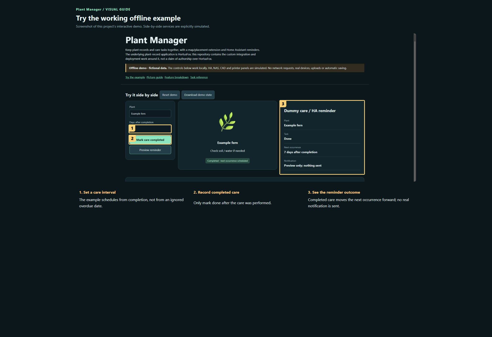

# Plant Manager — visual user manual

[Project overview](../README.md) · [Offline interactive demo](../demo.html)

Start with the numbered picture guide. Each number identifies the exact highlighted control. Work through one step at a time; the longer reference is below it.

### Try the working offline example

Screenshot of this project’s interactive demo. Side-by-side services are explicitly simulated.

1. **Set a care interval.** The example schedules from completion, not from an ignored overdue date.
2. **Record completed care.** Only mark done after the care was performed.
3. **See the reminder outcome.** Completed care moves the next occurrence forward; no real notification is sent.

## Detailed task reference

### Start a plant record

1. Choose Add Plant and enter a useful name and location. Add a clear photo and notes that help distinguish it from similar plants.
2. Keep identification uncertainty explicit. A probable identification should not silently become a confirmed species.
3. Use Search or Locations to return to the plant; the map is a placement aid rather than a replacement for its care record.

### Create useful care tasks

1. Open Tasks and Create new. Give the task a clear action, description and due date. Associate it with the relevant plant through the task/plant controls.
2. Keep watering and fertiliser schedules separate. Set recurrence only when appropriate for that task.
3. After checking the plant and performing the care, mark the task done. The custom recurrence worker advances from processing completion; overdue work stays due until completed.

### Use reminders and history

1. Review the due/overdue list before acting. A notification is a prompt to inspect conditions, not an instruction to water dry and wet pots alike.
2. Open the plant history or completed-task list to check what was actually recorded.
3. If recurrence/reminders stop, inspect the custom worker and HA connection. Do not also enable an independent recurrence cron that advances tasks regardless of completion.

### Identify from a photo

1. Use the identification/quick-scan control and choose a clear photo only if you intend to send it to the configured recognition service.
2. Compare the candidates with visible plant characteristics; keep uncertainty in the record.
3. Recognition credentials belong in the protected application configuration, not in an exported project or public issue.

## Keep your work

The database, uploads, task state and reminder state live on the NAS. Back up the database consistently together with photos and configuration. The Git repository contains custom source, not the live collection or service keys.

## If something looks wrong

- No notification: check due tasks, configured quiet hours, notification target and worker errors.
- Task repeats unexpectedly: check for a second recurrence mechanism.
- Photo recognition unavailable: check service configuration/quota without exposing the key.

## What this manual does not promise

HortusFox and its dependencies retain their upstream licences. This package requires the underlying plant application, database, gateway and configured reminder worker. The demo simulates a care queue without sending notifications.

Screenshots show the actual application where captured. The offline demo is a deliberately smaller simulation and identifies its dummy services. It never controls devices, sends notifications, uploads files or launches printing.
